# Dual-Mode Ping-Pong Ball Collector

**English** | [简体中文](README.zh-CN.md)

> An open-source robot that can be driven by Bluetooth or collect ping-pong balls autonomously with OpenMV vision.

**License:** MIT · **MCU:** STM32F407VET6 · **Vision:** OpenMV H7 · **CAD:** SolidWorks · **Status:** reproducible prototype

An open-source dual-mode ping-pong ball collector: Bluetooth remote control for daily use, and an OpenMV-based visual servo mode that finds, centers on, approaches and collects balls automatically. The repository includes firmware, vision scripts, an Android APK, protocol tools, mechanical CAD/STL files and technical documentation.

<p align="center">
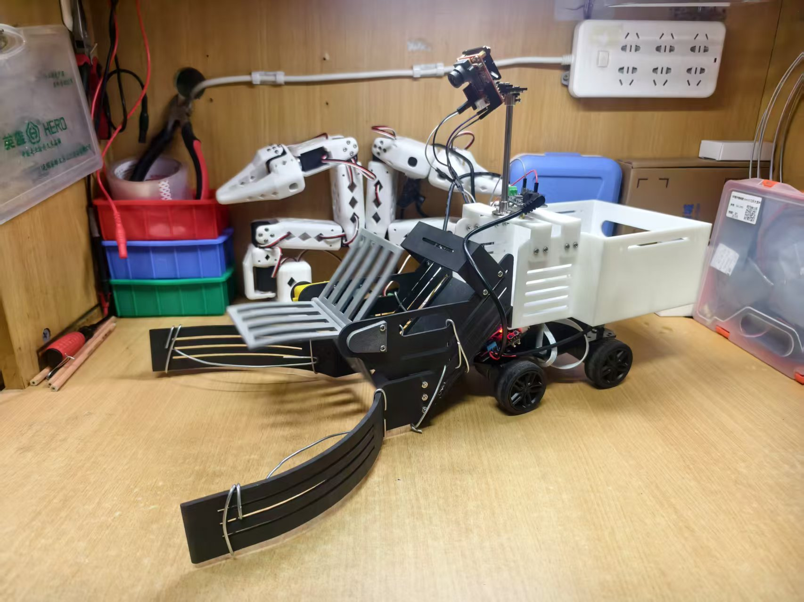
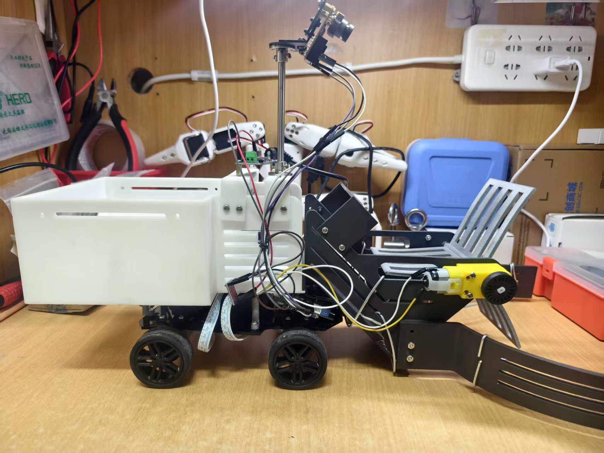
</p>

## Overview

After a ping-pong training session, balls are scattered across the floor and usually have to be picked up by hand. This project builds a dual-mode collector: a wheeled chassis handles navigation, while a three-blade mechanism at the front sweeps balls into a rear storage bin. The car can be driven remotely from a phone over Bluetooth, or switched to visual servo mode where OpenMV finds a ball, centers it, approaches it and collects it.

The controller is a **C30D (STM32F407VET6)** board, paired with a four-wheel differential chassis and an independent blade motor. The mechanical structure is designed in **SolidWorks**, and most printed parts are nylon/resin. The bill of materials and machining cost is **CNY 1,398.97** at the time of build (prices vary; see [Cost](#cost)).

- The goal is not a demo-only prototype: mechanical, electrical, firmware and mobile parts are all meant to be reproducible and easy to modify.
- Visual mode has no independent obstacle avoidance. Test only on flat, enclosed surfaces, and recalibrate parameters for each venue and lighting condition.

The design goals fall into four groups:

- **Function**: drive, steer and collect from a phone; or switch to visual servoing so the car finds, centers on, approaches and collects balls on its own.
- **Structure**: a chassis that carries the load; a collector that balances inlet width, ball guiding, ground clearance and anti-jam behaviour; a body that is cheap to build, easy to assemble and open to modification.
- **Control**: four-wheel differential drive, blade start/stop and speed control, Bluetooth commands, OLED status and dual-mode switching.
- **Validation**: assembly, simulation, firmware debugging and field demos all count; collection rate, runtime, cost and reliability need data collected under consistent conditions.

## Features

- **Dual mode**: Bluetooth remote control / visual servo auto-collection. Remote mode is the power-on default; switch with the C30D USER button or the Android app.
- **Four-wheel differential chassis**: four encoder motors, 200 Hz control loop, four independent PI speed loops, 7 speed levels.
- **Active collection mechanism**: three-blade rotor plus a rear ball bin; a separate 5 V blade motor is driven by a TB6612 with 7 duty levels.
- **Vision**: OpenMV H7 uses Hough-circle detection plus color validation, with equivalent HSV and LAB implementations. It streams fixed-length frames at 20–25 Hz and reports up to four targets per frame.
- **Human-machine interface**: 128×64 OLED shows target/actual speed, gear, blade duty and battery voltage; a 9-axis IMU provides attitude data.
- **Android console**: eight-way joystick, 7-level chassis/blade controls, mode switch, stop button, telemetry and event log.
- **Complete mechanical package**: SolidWorks parts, STL print files, assembly drawings and multi-view assembly photos.

## System Architecture

The design is organized as four layers — mechanical, electrical, embedded and host software — corresponding to the CORE modules:

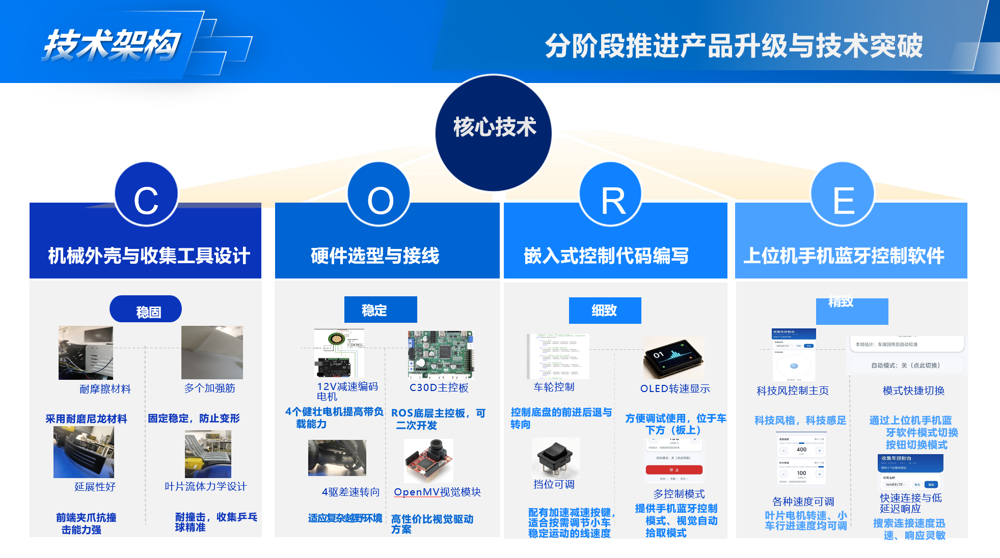

| Layer | Module | Key content |
|---|---|---|
| C — Mechanical | Enclosure and collection mechanism | Nylon/resin printed parts, ribs, three-blade rotor, guide claws, ball bin |
| O — Electrical | Hardware selection and wiring | C30D controller, four-wheel chassis, TB6612 + 5 V blade motor, OpenMV H7, HC-02 Bluetooth, OLED |
| R — Embedded | C30D firmware | Differential drive, encoder closed loop, Bluetooth protocol, visual servo, mode switching, OLED |
| E — Host | Android app | Bluetooth SPP, joystick/gears, mode switch, telemetry |

The layers meet at explicit interfaces: the mechanical layer defines mounting holes and motion envelopes, the electrical layer provides power and signal paths, the embedded layer outputs PWM/direction signals, and the host layer sends commands over Bluetooth. This keeps changes in one layer from rippling through the others.

## Hardware

| Category | Device / solution | Key parameters |
|---|---|---|
| Controller | WHEELTEC C30D (purchased) | STM32F407VET6, integrated 4-channel chassis driver |
| Chassis | WHEELTEC R1 four-wheel differential kit | 4 × MG310P20 encoder motors, 7.4 V |
| Vision | OpenMV4 H7 | UART3 ↔ C30D UART4, 115200 8N1 |
| Collection | 5 V DC blade motor + TB6612FNG | Independent supply/driver, 7-level PWM |
| Communication | HC-02 Bluetooth bridge | USART2, 9600 bps, classic Bluetooth SPP |
| Display | 0.96" OLED (SSD1306) | 128×64, I²C |
| Power | 12 V Li-ion battery + DCDC buck | Nominal 12 V / 2550 mAh |
| Interaction | C30D USER button, buzzer | Mode-switch feedback |

> The C30D and WHEELTEC R1 chassis are purchased parts. Their BSP and vendor documentation remain under the vendor's terms; see [THIRD_PARTY_NOTICES.md](THIRD_PARTY_NOTICES.md).

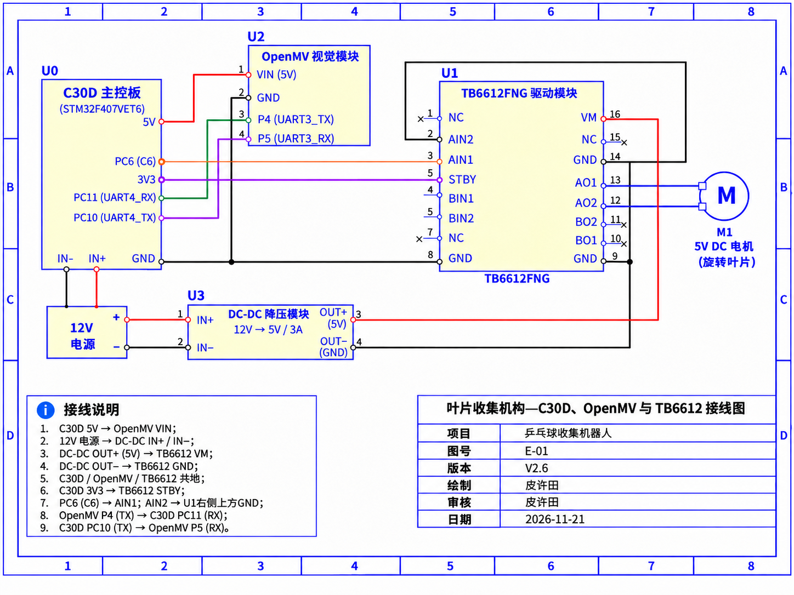

The diagram above shows the wiring between C30D, OpenMV, TB6612 and the 12 V→5 V DCDC converter: OpenMV and C30D are cross-connected over UART (TX↔RX) with a shared ground; C30D pin PC6 drives the blade PWM input of TB6612, which powers the 5 V blade motor M1; the 12 V battery is stepped down to 5 V by the DCDC module to feed the driver and blade motor. For the full pin table, voltage levels and power-up order, see [`docs/en/wiring.md`](docs/en/wiring.md).

Three wiring rules:

1. GND must be shared — connecting only TX/RX causes intermittent failures.
2. Route the signal harness away from motor PWM and blade-motor lines; add a ferrite bead if needed.
3. Do not power OpenMV from the C30D 5V rail while the USB cable is also plugged in; during debugging, USB alone is enough.

## Quick Start

### 1. Build and flash the firmware

1. Install Keil uVision 5 (MDK-ARM) and the STM32F4 device support package.
2. Open [`firmware/Fusion_OpenCar.uvprojx`](firmware/Fusion_OpenCar.uvprojx).
3. Build and confirm 0 errors.
4. Flash with ST-Link or FlyMcu.
5. **Power off the C30D and disconnect the OpenMV UART cable before flashing.** Reconnect after flashing, verify the wire order, then power up.

The prebuilt [`releases/Fusion_OpenCar.hex`](releases/Fusion_OpenCar.hex) is for quick verification only; rebuilding from source is the reference.

### 2. Run the OpenMV vision script

1. Open OpenMV IDE and connect the OpenMV H7.
2. Open [`openmv/main_circle_pos.py`](openmv/main_circle_pos.py) (HSV) or [`openmv/main_lab.py`](openmv/main_lab.py) (LAB).
3. Calibrate color thresholds, `CIRCLE_THRESHOLD`, `R_MIN/R_MAX` and related parameters for the venue lighting.
4. Save the script to OpenMV as `main.py`, run it, and confirm that balls are boxed and frames are sent over UART.
5. Wiring: OpenMV P4 (TX) → C30D PC11 (RX), P5 (RX) → C30D PC10 (TX), common GND, C30D 5V → OpenMV VIN.

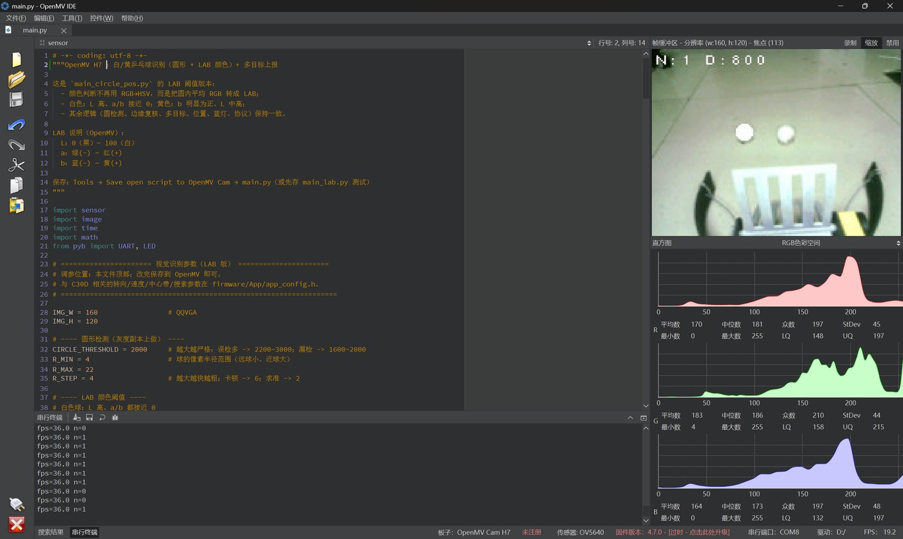

For calibration and debugging details, see [`docs/en/calibration.md`](docs/en/calibration.md), [`docs/en/control.md`](docs/en/control.md) and [`docs/en/protocol.md`](docs/en/protocol.md).

### 3. Install the Android console

1. Install [`app/收集车控制台V3.3.apk`](<app/收集车控制台V3.3.apk>) and enable Bluetooth.
2. Pair the HC-02 module in system settings.
3. Open “收集车控制台”, select the device and connect.
4. Use the eight-way joystick/gear bar for driving; tap the mode button for visual servo auto-collection.

<p>
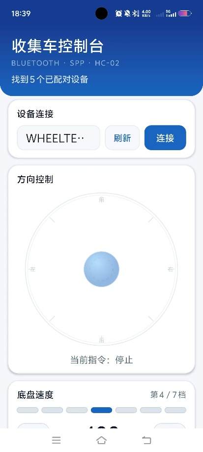
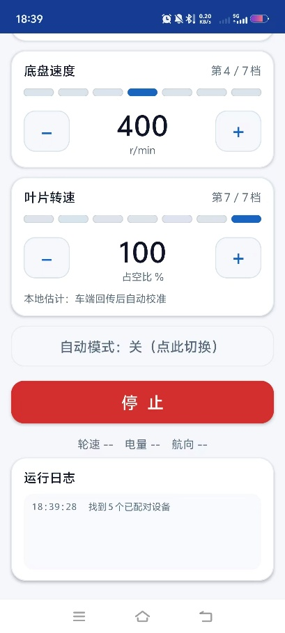
</p>

The app is distributed as an APK. Package name `com.pxt.carcontrol`, versionName `3.3`, versionCode `6`.

The UI does not use XML layouts: `MainActivity` builds the main screen in `onCreate` through the `Ui` class, and the joystick and gear bar are custom `JoystickPad` / `GearBar` views drawn with Canvas, so they scale to different screen sizes.

### 4. Power-up and test order

1. Raise the wheels off the ground and verify direction, gears, stop button and OLED display.
2. For blade testing, disconnect blade power first; verify direction and duty before applying load.
3. Connect OpenMV last; verify UART frames and mode switching.
4. Test visual mode only on flat, enclosed surfaces. Keep the stop button within reach.

## Repository Layout

```text
.
├── firmware/              C30D firmware (Keil / C / STM32F4 StdPeriph)
├── openmv/                OpenMV H7 MicroPython scripts
├── hardware/mechanical/   Mechanical CAD, STL, drawings and assembly photos
├── app/                   Android console V3.3 (APK)
├── tools/                 PC-side protocol simulator and debugging tools
├── docs/                  Protocol, control, wiring, calibration
├── media/                 Wiring diagrams, CAD screenshots, field photos
├── releases/              Prebuilt firmware (hex, for reference only)
├── LICENSE                MIT
└── THIRD_PARTY_NOTICES.md Third-party components and licenses
```

## Documentation

| Document | Content |
|---|---|
| [`docs/en/wiring.md`](docs/en/wiring.md) | C30D ↔ OpenMV four-wire connection, levels and power-up order |
| [`docs/en/protocol.md`](docs/en/protocol.md) | Vision frame format, TYPE definitions, CRC and examples |
| [`docs/en/control.md`](docs/en/control.md) | Mode switching, visual servo control, Bluetooth commands |
| [`docs/en/calibration.md`](docs/en/calibration.md) | Camera mounting, pixel/distance calibration, threshold tuning |
| [`hardware/mechanical/README.md`](hardware/mechanical/README.md) | Part list, materials, fasteners and assembly notes |
| [`hardware/mechanical/previews/README.md`](hardware/mechanical/previews/README.md) | Multi-view assembly references and part previews |

## Mechanical Design and 3D Models

Mechanical files live in [`hardware/mechanical/`](hardware/mechanical/), organized by part models, print files, drawings and previews:

```text
hardware/mechanical/
├── solidworks/
│   ├── parts/          13 × *.SLDPRT part models
│   └── drawings/       Assembly drawing (DWG)
├── stl/                11 × *.STL print files
├── previews/           Multi-view assembly photos + 10 part previews
└── README.md           Part list, materials, fasteners and printing notes (English / 中文)
```

**Collection path**: left/right curved claws guide scattered balls toward the inlet → the three-blade rotor pushes them through the channel → the rear bin stores them. One end of the rotor shaft is driven by the motor; the other end is supported by a bearing, located by the bearing cover. Single/double brackets raise the rear bin, while the front top baffle and reinforced arch top provide cross-bracing and mounting points for the DCDC converter.

Four things to check during assembly: rotor positioning at the front, left/right claw mounting, the transition from the guide channel into the rear bin, and the layout of the control board, motor driver and harness. Printed-part tolerances and real stiffness must be corrected with physical tests — the model alone is not enough.

**Motion simulation**: a SolidWorks motion study checks how the front rotor turns relative to the chassis and how rotor, ball and guide channel relate geometrically. The point is not to claim fluid-dynamics results without supporting data, but to catch obvious interference, confirm the rotor direction helps push balls backwards, and verify that the claw opening and guide ramp form a continuous path. Simulation must be followed by physical testing: printed-part assembly error introduces collisions the model does not show.

### Assembly References

| Front collection mechanism | Full car, side view |
|---|---|
| 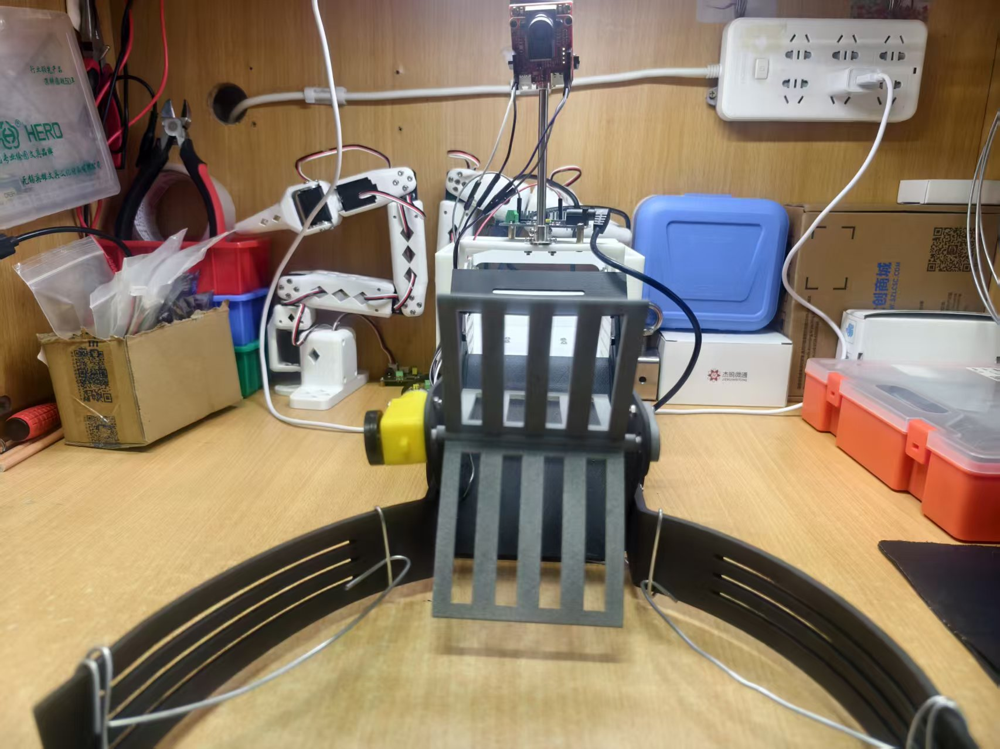 |  |

More views and part previews are in [`hardware/mechanical/previews/README.md`](hardware/mechanical/previews/README.md). The two CAD images below show the assembly and exploded layout.

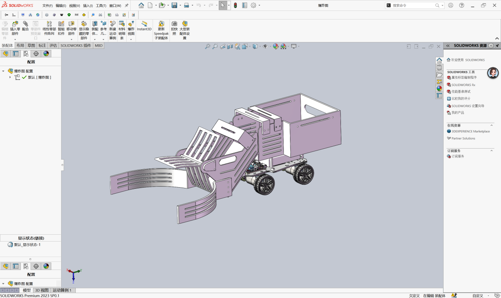

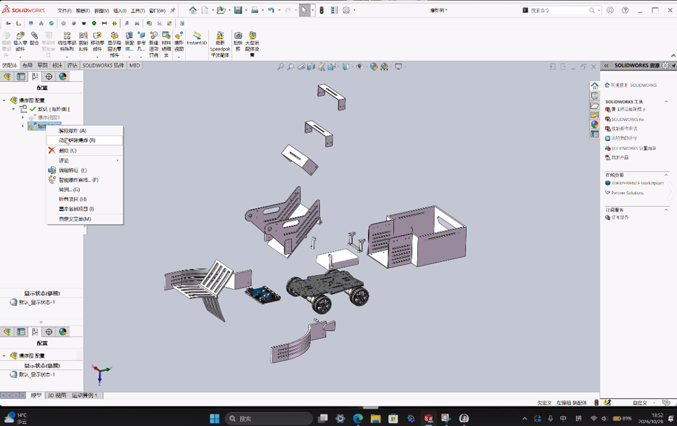

### Main Parts

| # | Part | Preview | SLDPRT | STL | Material / process | Qty | Purpose |
|---|---|---|---|---|---|---|---|
| 1 | Storage bin | [preview](hardware/mechanical/previews/01-storage-box.png) | [model](<hardware/mechanical/solidworks/parts/后备箱.SLDPRT>) | [STL](<hardware/mechanical/stl/后备箱.STL>) | 9600 resin | 1 | Stores collected balls |
| 2 | Bearing cover | [preview](hardware/mechanical/previews/02-bearing-cover.png) | [model](<hardware/mechanical/solidworks/parts/盒盖.SLDPRT>) | [STL](<hardware/mechanical/stl/盒盖.STL>) | PA12 | 1 | Locates the free-end bearing |
| 3 | Three-blade rotor | [preview](hardware/mechanical/previews/03-blade.png) | [model](<hardware/mechanical/solidworks/parts/叶片.SLDPRT>) | [STL](<hardware/mechanical/stl/叶片.STL>) | PA12 | 1 set | Rotates and pushes balls |
| 4 | Blade shaft (roller coupling) | [preview](hardware/mechanical/previews/04-blade-shaft.png) | [model](<hardware/mechanical/solidworks/parts/叶片轴（滚轴交接）.SLDPRT>) | [STL](<hardware/mechanical/stl/叶片轴（滚轴交接）.STL>) | BJ-316L stainless steel | 1 | Axial coupling of rotor and roller |
| 5 | Left guide claw | [preview](hardware/mechanical/previews/05-guide-claws.png) | [model](<hardware/mechanical/solidworks/parts/左爪.SLDPRT>) | [STL](<hardware/mechanical/stl/左爪.STL>) | 3201PA-F | 1 | Left curved guide |
| 6 | Right guide claw | [preview](hardware/mechanical/previews/05-guide-claws.png) | [model](<hardware/mechanical/solidworks/parts/右爪.SLDPRT>) | [STL](<hardware/mechanical/stl/右爪.STL>) | 3201PA-F | 1 | Right curved guide |
| 7 | Front top baffle | [preview](hardware/mechanical/previews/06-front-top-baffle.png) | [model](<hardware/mechanical/solidworks/parts/前挡顶.SLDPRT>) | [STL](<hardware/mechanical/stl/前挡顶.STL>) | 3D printed (material TBD) | 1 | Front cross member / alignment |
| 8 | Single bracket | [preview](hardware/mechanical/previews/07-single-bracket.png) | [model](<hardware/mechanical/solidworks/parts/单支架.SLDPRT>) | [STL](<hardware/mechanical/stl/单支架.STL>) | PA12 | 2 | Raises and adjusts the rear bin |
| 9 | Double bracket | [preview](hardware/mechanical/previews/08-double-bracket.png) | [model](<hardware/mechanical/solidworks/parts/双支架.SLDPRT>) | [STL](<hardware/mechanical/stl/双支架.STL>) | PA12 | 1 set | Dual-side support |
| 10 | Reinforced arch top | [preview](hardware/mechanical/previews/09-arch-top.png) | [model](<hardware/mechanical/solidworks/parts/拱顶（强化）.SLDPRT>) | [STL](<hardware/mechanical/stl/拱顶(强化）.STL>) | 9600 resin | 2 | Cross beam / DCDC mounting |
| 11 | Front collector body | [preview](hardware/mechanical/previews/assembly-front.jpg) | [model](<hardware/mechanical/solidworks/parts/车前端.SLDPRT>) | [STL](<hardware/mechanical/stl/车前端.STL>) | 3201PA-F | 1 | Main front collection body |
| 12 | 605.ZZ bearing | [preview](hardware/mechanical/previews/10-bearing-605zz.png) | — | — | Purchased (5 × 11 × 5 mm) | 1 | Low-friction free-end support |

Auxiliary model: [`电池.SLDPRT`](<hardware/mechanical/solidworks/parts/电池.SLDPRT>); assembly drawing: [`hardware/mechanical/solidworks/drawings/装配工程图.DWG`](<hardware/mechanical/solidworks/drawings/装配工程图.DWG>). See [`hardware/mechanical/README.md`](hardware/mechanical/README.md) for the full list and printing notes.

### Fasteners

M3 hardware, assembly quantities: M3×8 × 4, M3×9 × 8, M3×10 × 6, M3×25 × 2, M3×30 × 2, M3×12 × 6, M3×7 × 8 — 36 screws and 36 M3 nuts in total. Buy in full packs.

### Printing and Assembly Notes

- STL files are exported in millimetres; check the bounding box and orientation in the slicer before printing.
- Printed parts can warp. During assembly, check rotor shaft alignment, bracket hole positions, blade clearance, and the transition from the front channel to the rear bin inlet.
- Recheck the free-end bearing, bearing cover and roller coupling for concentricity and rotation resistance.
- A bent wire can be added to each guide claw as a stop to reduce ball jams.

## Visual Servo Auto-Collection

### Recognition Pipeline

OpenMV first finds candidate balls with a Hough circle transform on the grayscale image, filters false circles using mean brightness and Canny edge density inside the circle, then samples RGB values to validate the color. Two equivalent color implementations are provided: `main_circle_pos.py` uses HSV, `main_lab.py` uses LAB; frame format and control logic are identical.

- White ball: HSV `S ≤ 0.28, V ≥ 0.60`; LAB `L ≥ 70, |a| ≤ 10, |b| ≤ 15`.
- Yellow ball: HSV `H 35–70°, S ≥ 0.35, V ≥ 0.45`; LAB `L ≥ 50, b ≥ 20, a ∈ [-10, 20]`.
- Up to four targets per frame, ranked by `0.6 × color similarity + 0.4 × shape similarity`.

### Control Strategy (C30D)

1. **Mode switch**: remote mode is the default; press the USER button or send `V` from the app. The buzzer beeps once.
2. **Centering**: a center band of ±1/5 frame width (QVGA ±32 px). Outside the band, turn in place; inside, drive forward.
3. **Speed**: 200 r/min base; when a ball is seen, ramp to 300 r/min at 100 r/min/s; return to 200 r/min on target loss/timeout.
4. **Lost-target hold**: when the ball rolls below the collection inlet, keep the last wheel speeds briefly (`VISION_LOST_HOLD_MS`).
5. **Search**: after 5 s without a valid target, rotate in ~60° segments with 3 s pauses, six segments (~360°).
6. **Target selection**: `score = 0.45×color + 0.30×shape + 0.15×area + 0.10×centering`; highest score wins.
7. **Blade control**: visual mode does not take over the blade; duty remains controlled by the remote gear.

Key parameters (full list in [`docs/en/calibration.md`](docs/en/calibration.md)):

| Parameter | Default | Description |
|---|---|---|
| `VISION_TURN_RATE` | 0.30 | Turn gain |
| `VISION_BAND_PX` | ±32 | Center band |
| `VISION_SPEED_BASE` / `TRACK` | 200 / 300 r/min | Base / tracking speed |
| `VISION_SPEED_RAMP` | 100 r/min/s | Acceleration ramp |
| `VISION_TIMEOUT_MS` | 300 ms | Target-loss timeout |
| `VISION_LOST_HOLD_MS` | 200 ms (up to 1000) | Lost-target hold |
| `VISION_STOP_AREA` | 4000 px | Stop / back-off area threshold |
| `VISION_SEARCH_AFTER_MS` | 5000 ms | Start search after |
| `VISION_SEARCH_60_MS` | 333 ms | Time per ~60° segment |
| `VISION_SEARCH_STEPS` | 6 | Number of search segments |

> Color thresholds depend strongly on lighting. Recalibrate with the OpenMV IDE histogram/threshold editor at each venue; change a few parameters at a time and verify on the car.

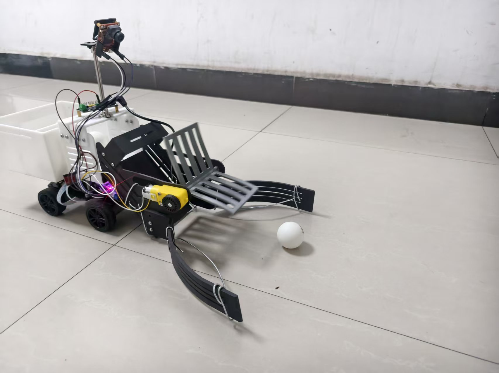

## Firmware Implementation

The Keil project entry point is `App/app_main.c`; the code is split into App and Hardware layers:

| File | Responsibility |
|---|---|
| `App/app_link.c` | Bluetooth protocol, parameter frames, command parsing |
| `App/app_chassis.c` | 7-gear speed mapping, per-wheel targets, incremental PI |
| `App/app_vision.c` | Vision frame parsing, servo decisions, no-ball search |
| `Hardware/vision_uart.c` | UART4 frame reception (interrupt + buffer) |
| `Hardware/motor.c`, `encoder.c` | PWM output, encoder counting |
| `Hardware/serial.c`, `screen.c`, `imu.c`, `adc.c` | Bluetooth UART, OLED, attitude, battery sampling |

The control tick is a TIM7 interrupt every 5 ms (200 Hz). Each tick first calls `vision_update()` to consume vision frames; Bluetooth direction `chassis_apply_command(g_link_dir)` runs only when vision mode is off; then the servo stays centered and `chassis_control_step()` reads all four encoders, converts to wheel speed, runs the PI loops and writes PWM.

- **Gear mapping**: `s_speed_set = GEAR_BASE_RPM + (gear - GEAR_CENTER) × GEAR_STEP_RPM` — center gear 3 is 400 r/min, range 100–700.
- **Speed conversion**: 30:1 gearbox, 13-line encoder, 4× decoding → 1560 counts per revolution; at 200 Hz, `n = ΔN / (30×13×4) × 200 × 60`.
- **Speed loop**: independent incremental PI per wheel, `Δu = Kp·(e_k − e_{k−1}) + Ki·e_k`, with `Kp=5.0`, `Ki=1.6`, internal limit ±16700, finally clamped to the PWM full scale of 16799.
- **Blade channel**: PC6 → TIM8_CH1, PSC=0, ARR=9999 → about 16.8 kHz; 100% duty maps to a compare value of 10000.

## Communication Protocol

Vision frames use a fixed-length binary format:

```text
AA 55 | TYPE | LEN | PAYLOAD ... | CRC8
```

- Multi-byte fields are little-endian; `CRC8` uses polynomial `0x07` (reflected `0x8C`), initial value 0, covering `TYPE/LEN/PAYLOAD`.
- Maximum payload is 16 bytes.

| TYPE | Name | Payload | Description |
|---|---|---|---|
| `0x01` | TARGET | `dx:int16, dy:int16, area:uint16, conf:uint8` | Single target offset, area, confidence |
| `0x05` | MULTI | `count:uint8 + [dx,dy,area,conf,round] × count` | Up to four targets |
| `0x02` | STATUS | `fps:uint8, mode:uint8` | Debug status (not currently sent) |
| `0x03` | CMD | `cmd:uint8` | Reserved |

For the complete frame definition, example and timing, see [`docs/en/protocol.md`](docs/en/protocol.md). On a PC, [`tools/protocol_sim.py`](tools/protocol_sim.py) can simulate OpenMV frames.

## Bluetooth Remote Control

- The app and HC-02 use classic Bluetooth SPP (RFCOMM), UUID `00001101-0000-1000-8000-00805F9B34FB`.
- Commands enter a single-threaded queue and are throttled by `CMD_GAP_MS` to avoid flooding the UART during long presses.
- Direction, gear, blade, mode-switch and stop commands are defined in [`docs/en/control.md`](docs/en/control.md) and `firmware/App/app_link.c`.
- The current app has no automatic reconnect or heartbeat; if Bluetooth drops during a long demo, reconnect manually.

## Cost

Total priced materials and machining: **CNY 1,398.97** (excluding on-hand Dupont wires):

| Item | Cost / CNY | Share |
|---|---:|---:|
| C30D controller | 359.00 | 25.7% |
| WHEELTEC R1 chassis | 339.60 | 24.3% |
| 3D-printed parts (front body, bin, blades, claws, brackets, etc.) | 416.44 | 29.8% |
| OpenMV4 H7 | 157.00 | 11.2% |
| Fasteners | 44.60 | 3.2% |
| Electrical, wiring, bearings and consumables | 82.33 | 5.9% |
| **Total** | **1,398.97** | **100%** |

Cost reduction: choose a lower-cost controller or used chassis where appropriate; nest printed parts, hollow large parts and reduce wall thickness; use PA-F or PLA for non-structural parts; buy fasteners, zip ties and wire in bulk.

## Known Issues

1. No ultrasonic/radar sensor; visual mode has **no independent obstacle avoidance**. Test only on flat, enclosed surfaces.
2. The 60° search segments are timed, not closed-loop; floor friction changes the actual angle.
3. Color thresholds depend on lighting; recalibrate at each venue.
4. RGB565 capture plus circle detection limits frame rate; small/distant balls are harder to detect.
5. The app has no reconnect/heartbeat; gear and step parameters are hard-coded.
6. Printed-part assembly errors can cause collisions not visible in CAD; continue validation with real assembly and long collection runs.

## Roadmap

- [ ] Complete BOM, tolerance records and a test matrix (collection rate, time, continuous runtime, energy, failures).
- [ ] Add ultrasonic collision avoidance; close the search-turn loop with the IMU.
- [ ] Upgrade vision to YOLO/OpenCV and make parameters configurable.
- [ ] Add app reconnect/heartbeat/configurable commands and publish the source.
- [ ] Document front-collector dimensions, bin mounting holes and shaft/bearing tolerances.
- [ ] Keep GitHub / Gitee / AtomGit releases in sync.

Iteration order is "reproduce first, optimize second, extend last": fix the critical assembly tolerances and print supports/wall thickness, re-check the concentricity and rotation resistance of the installed bearing, bearing cover and roller coupling; then use parameter logs and a test matrix to tune blade speed, chassis speed and turning strategy.

## License and Third-Party Components

- Original code, documentation and mechanical CAD are released under the [MIT License](LICENSE).
- CMSIS and the STM32F4 Standard Peripheral Library under `firmware/Driver/` belong to STMicroelectronics and remain under their own license; MIT does not cover them.
- The WHEELTEC C30D board, R1 chassis, OpenMV firmware/IDE, Android SDK and other third-party components remain under their respective licenses.
- See [THIRD_PARTY_NOTICES.md](THIRD_PARTY_NOTICES.md) for details.

## Contributing

Issues and pull requests are welcome: bug fixes, documentation, parameter tuning and tests. For changes to vision/control parameters, include the venue, lighting, ball count and other test conditions so that a parameter set is not accepted just because it worked once on one car.

If this project helps you, please Star the repository. When using it in coursework, presentations or public write-ups, please cite the project name and repository URL.

## Acknowledgements

Thanks to WHEELTEC for the chassis and C30D platform documentation, the OpenMV open-source ecosystem, and all team members who contributed to assembly, debugging and field testing.
