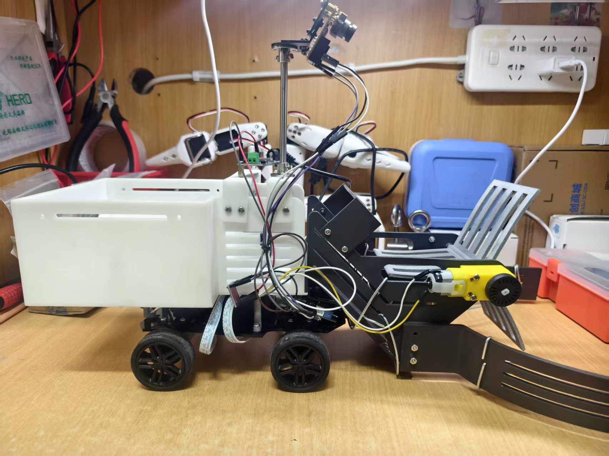
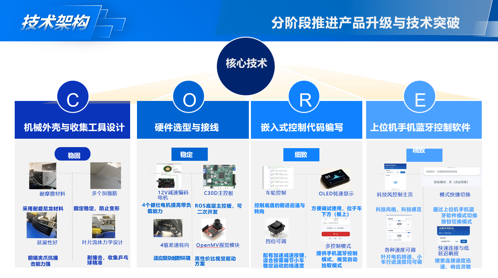
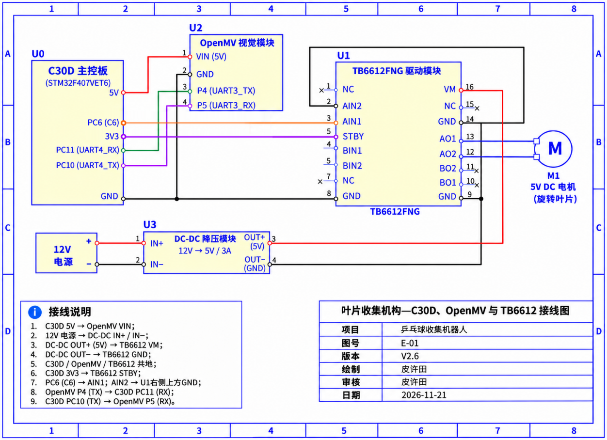
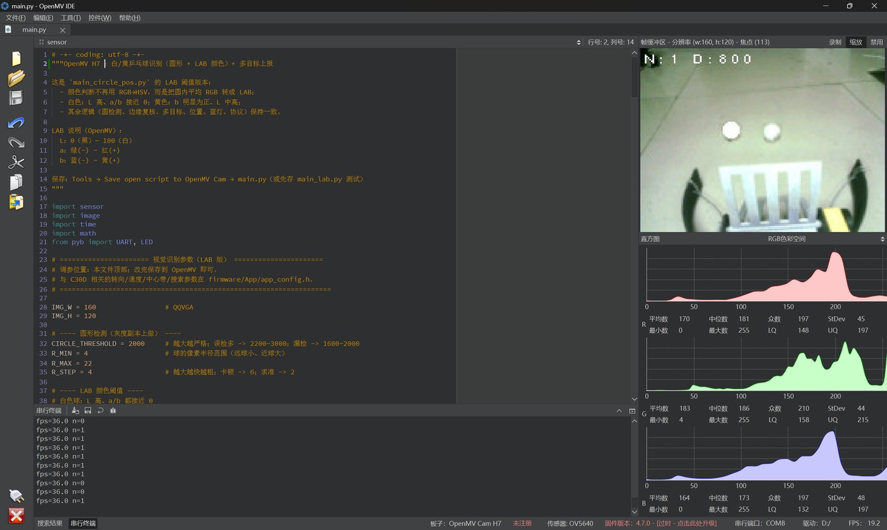
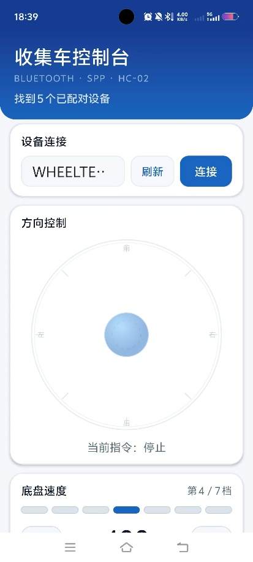
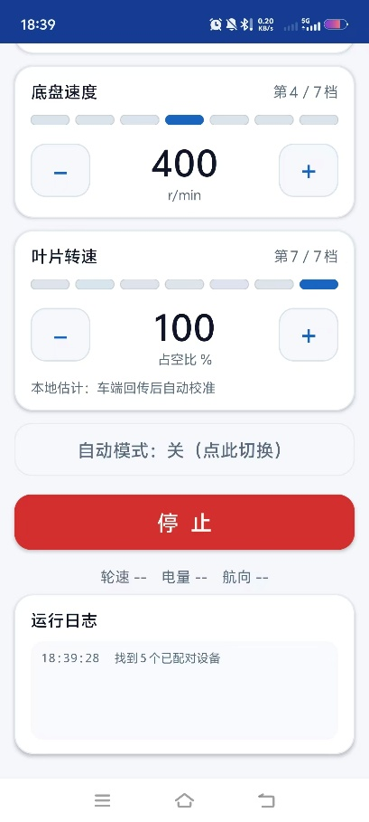
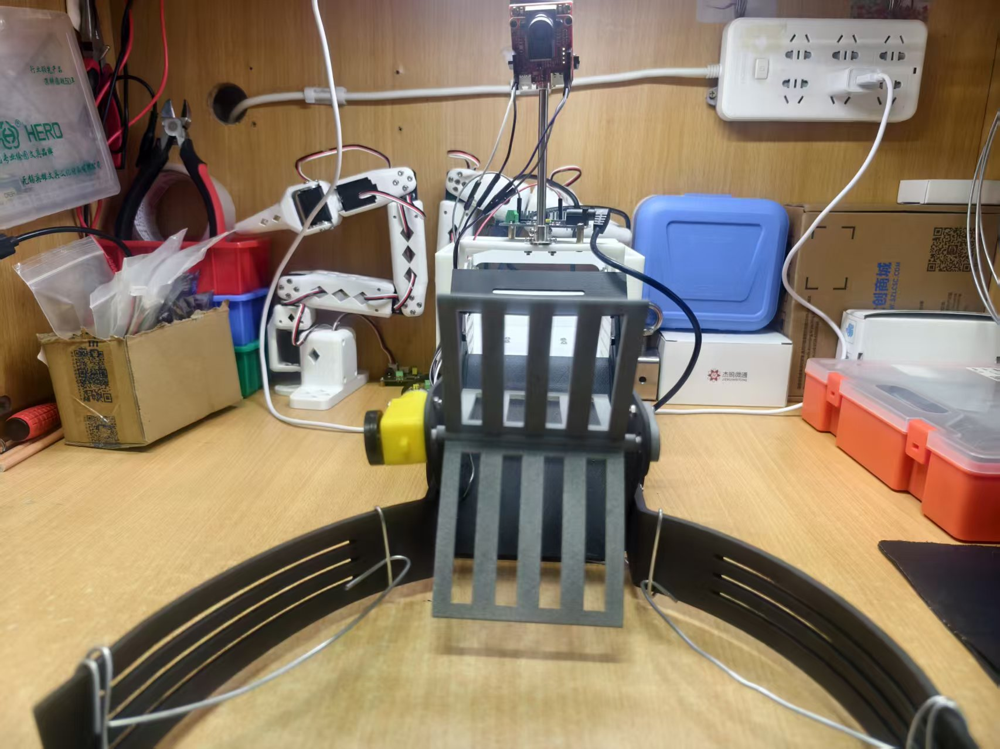
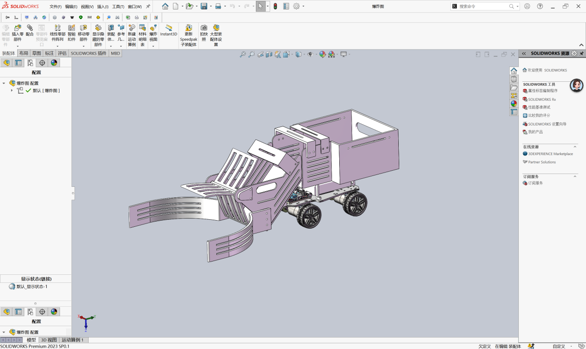
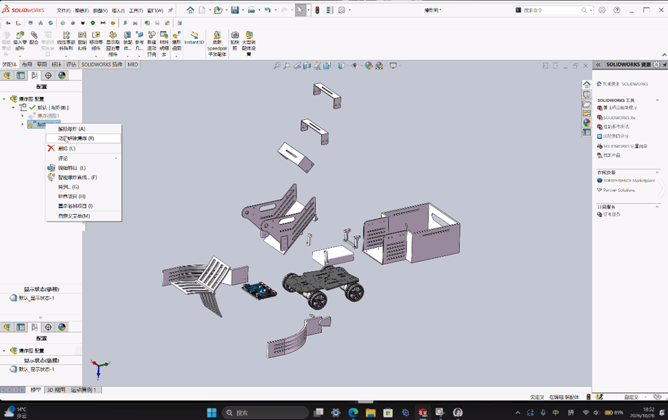
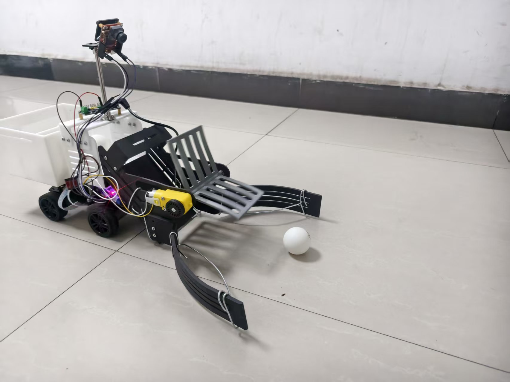

# 双模式乒乓球收集车 · PingPong Collector

[English](README.md) | **简体中文**

> 一辆能蓝牙遥控、也能视觉自动找球收球的开源乒乓球收集车。

**License:** MIT · **MCU:** STM32F407VET6 · **Vision:** OpenMV H7 · **CAD:** SolidWorks · **Status:** 可复现样机

一个开源的双模式乒乓球收集车：日常用蓝牙遥控，切到视觉模式后由 OpenMV 做视觉伺服，自动找球、对中、接近并收球。仓库包含固件、视觉脚本、Android APK、协议调试工具、机械 CAD/STL 模型和技术文档。



## 项目简介

乒乓球训练结束后，散落在场地上的球通常还要靠人弯腰一个个捡。本项目做了一台双模式收集车：轮式底盘负责走位，前端三叶片机构把球拨进后置储球箱；日常用手机蓝牙遥控，切到视觉伺服自动拾取模式后，OpenMV 会自己找球、对中、接近并收球。两种模式既能按 C30D 板上的 USER 按键切换，也能点自研蓝牙 App 里的模式切换按钮切换。

整车以 **C30D（STM32F407VET6）** 为主控，配四轮差速底盘和独立叶片驱动，结构用 **SolidWorks** 设计，打印件以尼龙/树脂为主。按明细计价，整机物料与加工合计 **1398.97 元**（价格随采购时间变化，明细见 [成本核算](#成本核算)）。

- 目标不是做一台只能演示的原型，而是把机械、电气、固件和手机端都做成能复现、能继续改的版本。
- 视觉模式没有独立避障，只在平整、封闭场地测试；参数需要按现场光照和地面重新标定。

## 主要特性

- **双模式**：蓝牙遥控 / 视觉伺服自动拾取，上电默认遥控模式；USER 按键或 App 按钮切换。
- **四驱差速底盘**：4 台编码减速电机，200 Hz 控制节拍，四路独立 PI 速度环，7 档速度。
- **主动收集机构**：三叶片旋转拨送 + 后置储球箱，独立 5 V 叶片电机经 TB6612 驱动，7 档占空比。
- **视觉识别**：OpenMV H7 采用“霍夫圆检测 + 颜色校验”，HSV 与 LAB 两套等价实现，20–25 Hz 定长帧上报，单帧最多 4 个目标。
- **人机交互**：128×64 OLED 显示转速、档位、叶片占空比、电池电压；九轴 IMU 姿态解算。
- **Android 控制台**：八方向摇杆、底盘/叶片七档调节、模式切换、停止、状态回显与运行日志。
- **完整机械资料**：SolidWorks 零件模型、STL 打印件、装配工程图，以及整车/零件预览图。

## 系统架构

方案按“机械—电气—嵌入式—上位机”四层组织，对应 CORE 四个模块：



| 层级 | 模块 | 关键内容 |
|---|---|---|
| C 机械 | 外壳与收集机构 | 尼龙/树脂打印件、加强筋、三叶片、导流爪、储球箱 |
| O 电气 | 硬件选型与接线 | C30D 主控、四驱底盘、TB6612 + 5 V 叶片电机、OpenMV H7、HC-02 蓝牙、OLED |
| R 嵌入式 | C30D 固件 | 差速驱动、编码器闭环、蓝牙协议、视觉伺服、模式切换、OLED |
| E 上位机 | Android App | 蓝牙 SPP、摇杆/档位、模式切换、状态回显 |

四层之间通过明确的接口衔接：机械层给出安装孔位和运动包络，电气层提供电源与信号通道，嵌入式层输出 PWM/方向信号，上位机通过蓝牙协议下发指令。这样一层改动能尽量少牵连其他层。

## 硬件清单

| 类别 | 设备/方案 | 关键参数 |
|---|---|---|
| 主控 | 轮趣科技 C30D（采购件） | STM32F407VET6，驱控一体，集成 4 路底盘驱动 |
| 底盘 | 轮趣 R1 四轮差速套件 | 4 × MG310P20 编码减速电机，7.4 V |
| 视觉 | OpenMV4 H7 | UART3 ↔ C30D UART4，115200 8N1 |
| 收集 | 5 V 直流叶片电机 + TB6612FNG | 独立供电/驱动，7 档 PWM |
| 通信 | HC-02 蓝牙透传 | USART2，9600 bps，经典蓝牙 SPP |
| 显示 | 0.96" OLED（SSD1306） | 128×64，I²C |
| 电源 | 12 V 锂电池 + DCDC 降压 | 电池标称 12 V / 2550 mAh |
| 交互 | C30D USER 按键、蜂鸣器 | 模式切换提示 |

> C30D 与轮趣 R1 底盘为采购件，其 BSP/资料遵循厂家许可，详见 [THIRD_PARTY_NOTICES.zh-CN.md](THIRD_PARTY_NOTICES.zh-CN.md)。



上图为 C30D、OpenMV、TB6612 与 DCDC 的模块级接线；OpenMV 四线连接、电平和上电顺序见 [`docs/wiring.md`](docs/wiring.md)。

## 快速开始

### 1. 编译与烧录固件

1. 安装 Keil uVision 5（MDK-ARM）和 STM32F4 器件支持包。
2. 打开 [`firmware/Fusion_OpenCar.uvprojx`](firmware/Fusion_OpenCar.uvprojx)。
3. 编译，确认 0 error。
4. 用 ST-Link 或 FlyMcu 烧录。
5. **烧录 C30D 前先断电，并断开 OpenMV 与 C30D 的 UART 连接线**；烧录完成后再恢复连接，核对线序后上电。

预编译 [`releases/Fusion_OpenCar.hex`](releases/Fusion_OpenCar.hex) 仅供参考，以源码重新编译为准。

### 2. 运行 OpenMV 视觉

1. 打开 OpenMV IDE，连接 OpenMV H7。
2. 打开 [`openmv/main_circle_pos.py`](openmv/main_circle_pos.py)（HSV 版）或 [`openmv/main_lab.py`](openmv/main_lab.py)（LAB 版）。
3. 按现场光照标定颜色阈值、`CIRCLE_THRESHOLD`、`R_MIN/R_MAX` 等参数。
4. 保存到 OpenMV 为 `main.py`，运行后确认能框出球、串口有帧输出。
5. 接线：OpenMV P4（TX）→ C30D PC11（RX），P5（RX）→ C30D PC10（TX），GND 共地，C30D 5V → OpenMV VIN。



参数与调试细节见 [`docs/calibration.md`](docs/calibration.md)、[`docs/control.md`](docs/control.md)、[`docs/protocol.md`](docs/protocol.md)。

### 3. 安装 Android 控制台

1. 手机安装 [`app/收集车控制台V3.3.apk`](<app/收集车控制台V3.3.apk>)，打开蓝牙。
2. 在系统设置里配对 HC-02。
3. 打开“收集车控制台”，选择设备并连接。
4. 用八方向摇杆/档位条遥控；点模式切换按钮进入视觉伺服自动拾取。

<p>


</p>

App 以 APK 形式提供；包名 `com.pxt.carcontrol`，versionName `3.3`，versionCode `6`。

### 4. 上电与调试顺序

1. 先架空车轮，确认方向、档位、急停和 OLED 显示正常。
2. 叶片调试先断开叶片电源，确认转向和占空比后再接负载。
3. 最后再接 OpenMV，确认串口帧和视觉模式切换正常。
4. 视觉模式只在平整、封闭场地测试；操作者保持随时可按停止按钮。

## 仓库结构

```text
.
├── firmware/              C30D 固件（Keil / C / STM32F4 标准外设库）
├── openmv/                OpenMV H7 端 MicroPython 脚本
├── hardware/mechanical/   机械 CAD、STL 打印件、工程图与装配参考图
├── app/                   Android 控制台 V3.3（APK）
├── tools/                 PC 端协议模拟与调试脚本
├── docs/                  协议、控制、接线、标定
├── media/                 接线图、CAD 截图、实拍照片
├── releases/              预编译固件（hex，仅供参考）
├── LICENSE                MIT
└── THIRD_PARTY_NOTICES.zh-CN.md 第三方组件与许可说明
```

## 文档索引

| 文档 | 内容 |
|---|---|
| [`docs/wiring.md`](docs/wiring.md) | C30D ↔ OpenMV 四线连接、电平与上电顺序 |
| [`docs/protocol.md`](docs/protocol.md) | 视觉链路帧格式、TYPE 定义、CRC 与示例 |
| [`docs/control.md`](docs/control.md) | 双模式切换、视觉伺服控制量、蓝牙指令 |
| [`docs/calibration.md`](docs/calibration.md) | 相机安装、像素/距离标定、阈值调试 |
| [`hardware/mechanical/README.zh-CN.md`](hardware/mechanical/README.zh-CN.md) | 3D 零件清单、材料、紧固件与装配要点 |
| [`hardware/mechanical/previews/README.zh-CN.md`](hardware/mechanical/previews/README.zh-CN.md) | 整车多视角装配图与 10 个主要零件预览 |

## 机械结构与 3D 模型

机械资料集中在 [`hardware/mechanical/`](hardware/mechanical/)，按零件、打印件、工程图和预览图分类整理：

```text
hardware/mechanical/
├── solidworks/
│   ├── parts/          *.SLDPRT 零件模型
│   └── drawings/       装配工程图 DWG
├── stl/                *.STL 打印件（可直接切片）
├── previews/           整车多视角参考图 + 主要零件预览
└── README.md           零件清单、材料、紧固件与打印说明（English / 中文）
```

**收球路径**：左右弧形爪把散球往入口引 → 三叶片旋转把球沿导流区推进 → 后置储球箱储存。旋转轴一端由电机驱动，另一端用轴承做自由端支承，盒盖负责轴承定位；单支架/双支架抬高后箱，前挡顶和拱顶负责横向连接与设备安装。

### 装配参考图

| 整车前部 / 收集机构 | 整车侧视 |
|---|---|
|  |  |

更多零件预览和对应模型见 [`hardware/mechanical/previews/README.zh-CN.md`](hardware/mechanical/previews/README.zh-CN.md)。下面两张是 CAD 装配与爆炸截图，用于理解整机构成。





### 主要零件

| # | 零件 | 预览 | SLDPRT | STL | 材料/工艺 | 数量 | 用途 |
|---|---|---|---|---|---|---|---|
| 1 | 后备箱 | [图](hardware/mechanical/previews/01-storage-box.png) | [模型](<hardware/mechanical/solidworks/parts/后备箱.SLDPRT>) | [STL](<hardware/mechanical/stl/后备箱.STL>) | 9600 树脂 | 1 | 储存收集到的乒乓球 |
| 2 | 盒盖 | [图](hardware/mechanical/previews/02-bearing-cover.png) | [模型](<hardware/mechanical/solidworks/parts/盒盖.SLDPRT>) | [STL](<hardware/mechanical/stl/盒盖.STL>) | PA12 | 1 | 固定自由端轴承 |
| 3 | 叶片（三叶式） | [图](hardware/mechanical/previews/03-blade.png) | [模型](<hardware/mechanical/solidworks/parts/叶片.SLDPRT>) | [STL](<hardware/mechanical/stl/叶片.STL>) | PA12 | 1 组 | 旋转拨送球体 |
| 4 | 叶片轴（滚轴交接） | [图](hardware/mechanical/previews/04-blade-shaft.png) | [模型](<hardware/mechanical/solidworks/parts/叶片轴（滚轴交接）.SLDPRT>) | [STL](<hardware/mechanical/stl/叶片轴（滚轴交接）.STL>) | BJ-316L 不锈钢 | 1 | 旋转轴与相邻件轴向衔接 |
| 5 | 左爪 | [图](hardware/mechanical/previews/05-guide-claws.png) | [模型](<hardware/mechanical/solidworks/parts/左爪.SLDPRT>) | [STL](<hardware/mechanical/stl/左爪.STL>) | 3201PA-F | 1 | 左侧弧形导流 |
| 6 | 右爪 | [图](hardware/mechanical/previews/05-guide-claws.png) | [模型](<hardware/mechanical/solidworks/parts/右爪.SLDPRT>) | [STL](<hardware/mechanical/stl/右爪.STL>) | 3201PA-F | 1 | 右侧弧形导流 |
| 7 | 前挡顶 | [图](hardware/mechanical/previews/06-front-top-baffle.png) | [模型](<hardware/mechanical/solidworks/parts/前挡顶.SLDPRT>) | [STL](<hardware/mechanical/stl/前挡顶.STL>) | 3D 打印（材料待补） | 1 | 前端横向连接/定位 |
| 8 | 单支架 | [图](hardware/mechanical/previews/07-single-bracket.png) | [模型](<hardware/mechanical/solidworks/parts/单支架.SLDPRT>) | [STL](<hardware/mechanical/stl/单支架.STL>) | PA12 | 2 | 抬高后箱、调整高度 |
| 9 | 双支架 | [图](hardware/mechanical/previews/08-double-bracket.png) | [模型](<hardware/mechanical/solidworks/parts/双支架.SLDPRT>) | [STL](<hardware/mechanical/stl/双支架.STL>) | PA12 | 1 组 | 双侧连接支撑 |
| 10 | 拱顶（强化） | [图](hardware/mechanical/previews/09-arch-top.png) | [模型](<hardware/mechanical/solidworks/parts/拱顶（强化）.SLDPRT>) | [STL](<hardware/mechanical/stl/拱顶%28强化）.STL>) | 9600 树脂 | 2 | 横梁、安装高度可调支架与 DCDC |
| 11 | 车前端 | [图](hardware/mechanical/previews/assembly-front.jpg) | [模型](<hardware/mechanical/solidworks/parts/车前端.SLDPRT>) | [STL](<hardware/mechanical/stl/车前端.STL>) | 3201PA-F | 1 | 前端收集机构主体 |
| 12 | 轴承 605.ZZ | [图](hardware/mechanical/previews/10-bearing-605zz.png) | — | — | 采购件（内 5 × 外 11 × 高 5） | 1 | 自由端低摩擦支承 |

辅助模型：`电池.SLDPRT`；工程图见 [`hardware/mechanical/solidworks/drawings/`](hardware/mechanical/solidworks/drawings/)，完整清单与打印说明见 [`hardware/mechanical/README.zh-CN.md`](hardware/mechanical/README.zh-CN.md)。

### 紧固件

统一 M3 国标件（装配用量）：M3×8 × 4、M3×9 × 8、M3×10 × 6、M3×25 × 2、M3×30 × 2、M3×12 × 6、M3×7 × 8，合计 36 个螺钉 + 36 个 M3 螺母。采购按整包另算。

### 打印与装配注意

- STL 单位按毫米导出；打印前在切片软件里核对尺寸与摆放方向。
- 打印件容易变形，装配重点检查：旋转轴同轴度、支架孔位、叶片运动间隙、前端导流路径与后箱入口的衔接。
- 已装机的自由端轴承、轴承定位盒盖和滚轴交接件要复核同轴度与旋转阻力。
- 左右导流夹可各加一根弯折铁丝做限位隔挡，减少卡球（见技术文档 9.1 节）。

## 视觉伺服自动拾取

### 识别流程

OpenMV 先在灰度图上用霍夫圆找候选球，再用圆内亮度和 Canny 边缘密度过滤假圆，最后在圆内采样 RGB 判断颜色。仓库保留两套等价颜色实现：`main_circle_pos.py` 用 HSV，`main_lab.py` 用 LAB；两版帧格式和控制逻辑完全一致。

- 白色球：HSV 下 `S ≤ 0.28, V ≥ 0.60`；LAB 下 `L ≥ 70, |a| ≤ 10, |b| ≤ 15`。
- 黄色球：HSV 下 `H 35–70°, S ≥ 0.35, V ≥ 0.45`；LAB 下 `L ≥ 50, b ≥ 20, a ∈ [-10, 20]`。
- 每帧最多上报 4 个目标，按“颜色相似度 × 0.6 + 形状相似度 × 0.4”排序。

### 控制策略（C30D 侧）

1. **模式切换**：上电默认遥控；USER 按键或 App 发送 `V` 切换，蜂鸣器短鸣。
2. **中心对中**：画面中心线两侧各 1/5 宽为中心带（QVGA 等效 ±32 px），带外原地慢转，进带才前进。
3. **速度控制**：默认 200 r/min；看到球按 100 r/min/s 升到 300 r/min；丢球/超时回 200 r/min。
4. **丢球续行**：目标滚到收集口下方时按最后轮速继续走一小段（`VISION_LOST_HOLD_MS`）。
5. **无球搜索**：5 s 无有效球后原地分段搜索，每段约 60°，段间停 3 s，共 6 段约 360°。
6. **多球选择**：`score = 0.45×颜色 + 0.30×形状 + 0.15×面积 + 0.10×居中`，取最高分。
7. **叶片控制**：视觉模式不接管叶片，占空比始终由遥控档位决定。

主要参数（完整列表见 [`docs/calibration.md`](docs/calibration.md)）：

| 参数 | 默认值 | 说明 |
|---|---|---|
| `VISION_TURN_RATE` | 0.30 | 转向幅度 |
| `VISION_BAND_PX` | ±32 | 中心带 |
| `VISION_SPEED_BASE` / `TRACK` | 200 / 300 r/min | 基础/跟踪速度 |
| `VISION_SPEED_RAMP` | 100 r/min/s | 加速梯度 |
| `VISION_TIMEOUT_MS` | 300 ms | 丢球判定 |
| `VISION_LOST_HOLD_MS` | 200 ms（可设 1000） | 丢球续行 |
| `VISION_STOP_AREA` | 4000 px | 停车面积阈值 |
| `VISION_SEARCH_AFTER_MS` | 5000 ms | 进入搜索 |
| `VISION_SEARCH_60_MS` | 333 ms | 每段约 60° |
| `VISION_SEARCH_STEPS` | 6 | 搜索段数 |

> 颜色阈值与光照强相关，换场地必须用 OpenMV IDE 的直方图/阈值编辑器重新标定；建议每次只改少量参数并做实车对比。



## 通信协议

视觉链路走二进制定长帧：

```text
AA 55 | TYPE | LEN | PAYLOAD ... | CRC8
```

- 多字节字段小端；`CRC8` 多项式 `0x07`（反射实现 `0x8C`），初值 0，覆盖 `TYPE/LEN/PAYLOAD`。
- 单帧最大载荷 16 字节。

| TYPE | 名称 | 载荷 | 说明 |
|---|---|---|---|
| `0x01` | TARGET | `dx:int16, dy:int16, area:uint16, conf:uint8` | 单目标偏移、面积、置信度 |
| `0x05` | MULTI | `count:uint8 + [dx,dy,area,conf,round] × count` | 最多 4 个目标 |
| `0x02` | STATUS | `fps:uint8, mode:uint8` | 调试用（当前未发送） |
| `0x03` | CMD | `cmd:uint8` | 预留 |

完整帧定义、示例与时序见 [`docs/protocol.md`](docs/protocol.md)；PC 端可用 [`tools/protocol_sim.py`](tools/protocol_sim.py) 模拟 OpenMV 发帧。

## 蓝牙遥控

- App 与 HC-02 使用经典蓝牙 SPP（RFCOMM），UUID `00001101-0000-1000-8000-00805F9B34FB`。
- 指令先进入单线程队列，按 `CMD_GAP_MS` 节流下发，避免长按连发挤满串口。
- 方向、档位、叶片、模式切换、停止等指令定义见 [`docs/control.md`](docs/control.md) 与 `firmware/App/app_link.c`。
- 当前 App 没有断线重连和心跳保活，长时间演示时若蓝牙断开需手动重连。

## 成本核算

已计价物料与加工合计 **1398.97 元**（不含手头存量杜邦线/导线）：

| 项目 | 金额/元 | 占比（约） |
|---|---:|---:|
| C30D 主控板 | 359.00 | 25.7% |
| 轮趣 R1 底盘 | 339.60 | 24.3% |
| 3D 打印件（车前端、后备箱、叶片、爪、支架等） | 416.44 | 29.8% |
| OpenMV4 H7 | 157.00 | 11.2% |
| 紧固件 | 44.60 | 3.2% |
| 电气/辅材/线材/轴承等 | 82.33 | 5.9% |
| **合计** | **1398.97** | **100%** |

降本方向：采购件优先选同系列低配主控或二手底盘；自研件按零件尺寸合并排版、大件中空/减薄、非受力件改用 PA-F 或 PLA；紧固件/扎带/铁丝按整包采购。

## 已知问题

1. 视觉模式没有超声波/雷达，**无独立避障**，只在平整、封闭场地测试。
2. 60° 分段搜索靠时间估算，没有陀螺仪角度闭环，地面摩擦变化会影响角度。
3. 颜色阈值依赖现场光照，换场地需重新标定。
4. RGB565 采集 + 圆检测帧率有限，远距离小球识别率会下降。
5. App 无断线重连/心跳；档位与步进参数目前写死在代码里。
6. 打印件装配误差会带来模型里没体现的碰撞，需用实物装配和连续收球测试继续验证。

## 路线图

- [ ] 补充完整 BOM、配合公差记录和测试矩阵（收集率、耗时、连续运行、能耗、故障）。
- [ ] 加超声波防撞；用 IMU 做搜索转向闭环。
- [ ] 视觉升级 YOLO/OpenCV，参数改为可配置项。
- [ ] App 增加断线重连、心跳保活、可配置指令集，并整理源码。
- [ ] 补齐前端收球机构局部尺寸、后箱安装孔位、旋转轴与轴承配合公差。
- [ ] 统一 GitHub / Gitee / AtomGit 三平台发布与 Release 资产。

## 开源协议与第三方

- 本项目原创代码、文档和机械 CAD **采用 [MIT License](LICENSE)**。
- `firmware/Driver/` 下的 CMSIS 与 STM32F4 标准外设库属于 STMicroelectronics，遵循其原有许可，MIT 不覆盖。
- 轮趣科技 C30D 主控板、R1 底盘，OpenMV 固件/IDE，Android SDK 等第三方组件遵循各自许可。
- 详见 [THIRD_PARTY_NOTICES.zh-CN.md](THIRD_PARTY_NOTICES.zh-CN.md)。

## 贡献

欢迎 Issue / PR：修 bug、补文档、改参数、加测试都行。涉及视觉/控制参数的改动，请附上场地、光照、球数等测试条件，避免“只在一台车上偶然有效”的参数进入默认值。

如果这个项目对你有帮助，欢迎 Star；用于课程设计、答辩或公开发布时请注明项目名称与仓库地址。

## 致谢

感谢轮趣科技提供的底盘与 C30D 平台资料、OpenMV 的开源生态，以及参与装配、调试和实车测试的全体队员。
