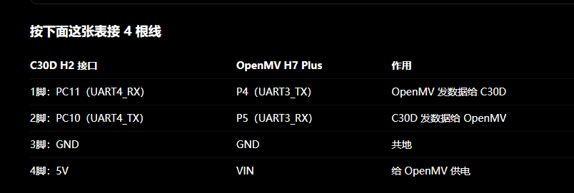

# Wiring: C30D ↔ OpenMV H7

[简体中文](../wiring.md) | **English**

## Four-wire connection (UART4 ↔ UART3)

| C30D H2 | OpenMV H7 | Direction / purpose |
|---|---|---|
| Pin 1 `PC11` (UART4_RX) | `P4` (UART3_TX) | OpenMV sends data to C30D |
| Pin 2 `PC10` (UART4_TX) | `P5` (UART3_RX) | C30D sends data to OpenMV |
| Pin 3 `GND` | `GND` | Common ground (required) |
| Pin 4 `5V` | `VIN` | Powers the OpenMV |

## Parameters

- Baud rate: **115200**, 8 data bits, 1 stop bit, no parity
- Level: 3.3 V TTL; **do not connect RS-232 levels**
- C30D side: UART4, `PC10/PC11` configured as AF8
- OpenMV side: UART3, `P4/P5`

## Notes

1. **Connect ground first.** TX/RX without GND causes intermittent communication errors.
2. OpenMV `VIN` accepts 3.7–5 V. When powered from C30D 5 V, do not also connect USB power (for debugging, use USB only and disconnect the 5 V wire).
3. Keep wires short (<20 cm) and away from motor/PWM wiring; use twisted pairs or a ferrite bead if needed.
4. Power-up order: wire everything first, then power the car. Power off before plugging/unplugging OpenMV.
5. If communication fails, first check that `PC10/PC11` are not used by another peripheral.
