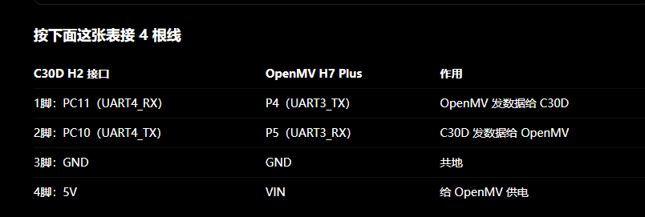

# 接线：C30D ↔ OpenMV H7

[English](en/wiring.md) | **简体中文**

## 四线连接（UART4 ↔ UART3）

| C30D H2 | OpenMV H7 | 方向 / 作用 |
|---|---|---|
| 1 脚 `PC11`（UART4_RX） | `P4`（UART3_TX） | OpenMV 发数据给 C30D |
| 2 脚 `PC10`（UART4_TX） | `P5`（UART3_RX） | C30D 发数据给 OpenMV |
| 3 脚 `GND` | `GND` | 共地（必须接） |
| 4 脚 `5V` | `VIN` | 给 OpenMV 供电 |

## 参数

- 波特率：**115200**，8 数据位、1 停止位、无校验
- 电平：3.3 V TTL，**不要接 RS232 电平**
- C30D 侧：UART4，`PC10/PC11` 复用为 AF8
- OpenMV 侧：UART3，`P4/P5`

## 注意事项

1. **共地必须先接**：只接 TX/RX 不接 GND，通信会随机出错。
2. OpenMV 的 `VIN` 可吃 3.7–5 V；用 C30D 的 5 V 供电时，不要再同时插 USB 供电（调试时可只插 USB，拔掉 5V 线）。
3. 线尽量短（<20 cm），远离电机线与 PWM 线；必要时用双绞或加磁环。
4. 上电顺序：先接好线，再给整车上电；插拔 OpenMV 前先断电。
5. 如果通信不通，先确认 C30D 的 `PC10/PC11` 没有被其它外设占用。
