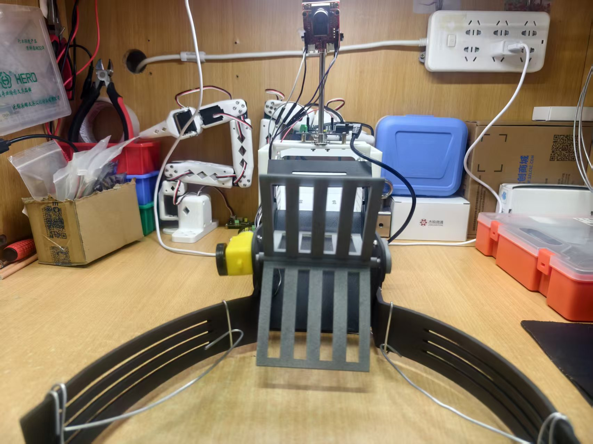
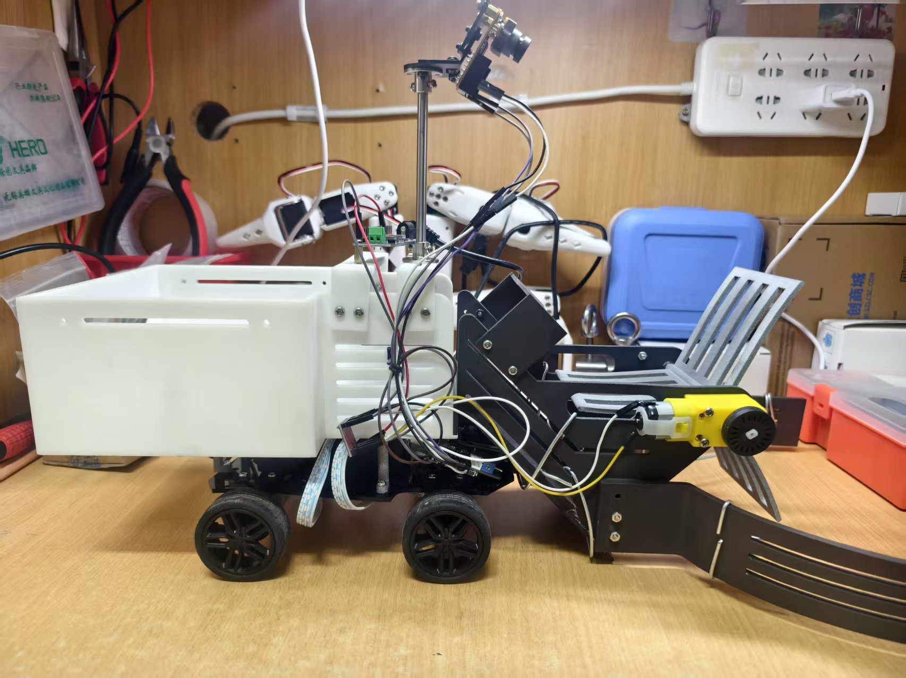

# 机械结构与 3D 模型

本目录是双模式乒乓球收集车的机械资料，按零件模型、打印件、工程图和预览图分类整理。

> 整机装配关系以 [`previews/`](previews/) 中的整车多视角照片和 [`solidworks/drawings/装配工程图.DWG`](<solidworks/drawings/装配工程图.DWG>) 为准，单件尺寸以 SLDPRT/STL 为准。

## 目录

```text
hardware/mechanical/
├── solidworks/
│   ├── parts/          13 个 *.SLDPRT 零件模型
│   └── drawings/       装配工程图 DWG
├── stl/                11 个 *.STL 打印件
├── previews/           整车多视角参考图 + 10 个主要零件预览
└── README.md
```

## 文件格式

| 格式 | 用途 | 打开方式 |
|---|---|---|
| `.SLDPRT` | SolidWorks 零件源文件，可改尺寸/特征 | SolidWorks 2020 及以上 |
| `.DWG` | 装配工程图（多视图、尺寸、公差） | AutoCAD / 兼容 CAD |
| `.STL` | 三角网格，用于切片打印 | Cura、PrusaSlicer、Bambu Studio、嘉立创等 |
| `.png` / `.jpg` | 装配参考图、零件预览 | 任意图片查看器 |

## 零件清单

| # | 零件 | 预览 | SLDPRT | STL | 材料/工艺 | 数量 | 用途/备注 |
|---|---|---|---|---|---|---|---|
| 1 | 后备箱（储球箱） | [图](previews/01-storage-box.png) | [模型](<solidworks/parts/后备箱.SLDPRT>) | [STL](<stl/后备箱.STL>) | 9600 树脂 | 1 | 后部储球；侧板与内侧加强结构承力 |
| 2 | 盒盖（轴承定位） | [图](previews/02-bearing-cover.png) | [模型](<solidworks/parts/盒盖.SLDPRT>) | [STL](<stl/盒盖.STL>) | PA12 | 1 | 固定自由端轴承；已装机 |
| 3 | 叶片（三叶式） | [图](previews/03-blade.png) | [模型](<solidworks/parts/叶片.SLDPRT>) | [STL](<stl/叶片.STL>) | PA12 | 1 组 | 旋转拨送；与球体接触 |
| 4 | 叶片轴（滚轴交接） | [图](previews/04-blade-shaft.png) | [模型](<solidworks/parts/叶片轴（滚轴交接）.SLDPRT>) | [STL](<stl/叶片轴（滚轴交接）.STL>) | BJ-316L 不锈钢 | 1 | 旋转轴与相邻连接件轴向衔接 |
| 5 | 左爪 | [图](previews/05-guide-claws.png) | [模型](<solidworks/parts/左爪.SLDPRT>) | [STL](<stl/左爪.STL>) | 3201PA-F | 1 | 左侧弧形导流，扩大入口 |
| 6 | 右爪 | [图](previews/05-guide-claws.png) | [模型](<solidworks/parts/右爪.SLDPRT>) | [STL](<stl/右爪.STL>) | 3201PA-F | 1 | 右侧弧形导流 |
| 7 | 前挡顶 | [图](previews/06-front-top-baffle.png) | [模型](<solidworks/parts/前挡顶.SLDPRT>) | [STL](<stl/前挡顶.STL>) | 3D 打印（材料待补） | 1 | 前端横向连接，辅助定位 |
| 8 | 单支架 | [图](previews/07-single-bracket.png) | [模型](<solidworks/parts/单支架.SLDPRT>) | [STL](<stl/单支架.STL>) | PA12 | 2 | 抬高后箱、调整高度 |
| 9 | 双支架 | [图](previews/08-double-bracket.png) | [模型](<solidworks/parts/双支架.SLDPRT>) | [STL](<stl/双支架.STL>) | PA12 | 1 组 | 双侧连接支撑 |
| 10 | 拱顶（强化） | [图](previews/09-arch-top.png) | [模型](<solidworks/parts/拱顶（强化）.SLDPRT>) | [STL](<stl/拱顶(强化）.STL>) | 9600 树脂 | 2 | 横梁式连接；安装可调支架、DCDC |
| 11 | 车前端 | 见 [整车前部图](previews/assembly-front.jpg) | [模型](<solidworks/parts/车前端.SLDPRT>) | [STL](<stl/车前端.STL>) | 3201PA-F | 1 | 前端收集机构主体 |
| 12 | 轴承 605.ZZ | [图](previews/10-bearing-605zz.png) | — | — | 采购件（内 5 × 外 11 × 高 5） | 1 | 自由端低摩擦旋转支承 |

辅助模型：`电池.SLDPRT`（电池包占位参考）；工程图见 [`solidworks/drawings/装配工程图.DWG`](<solidworks/drawings/装配工程图.DWG>)。

> `拱顶(强化）.STL` 使用半角左括号 + 全角右括号，引用时请照抄文件名。

## 装配参考图

整车装配照片和主要零件预览见 [`previews/README.md`](previews/README.md)。

| 整车前部 | 整车侧视 |
|---|---|
|  |  |

装配时重点看：左右爪方向、叶片与导流通道间隙、轴承/盒盖/滚轴同轴度、后箱入口与前端通道的高度对齐。

## 材料与数量

| 材料 | 零件 | 说明 |
|---|---|---|
| 9600 树脂 | 后备箱、拱顶（强化） | 哑光白，后箱打磨-粗磨 |
| 3201PA-F | 左爪、右爪、车前端 | 灰黑，兼顾韧性与耐撞 |
| PA12 | 叶片、盒盖、单支架、双支架 | 灰黑，叶片为受力旋转件 |
| BJ-316L 不锈钢 | 叶片轴 | 耐磨、防锈 |
| 采购件 | 轴承 605.ZZ、M3 紧固件 | 深沟球轴承 1 个 |

3D 打印合计约 416.44 元（嘉立创报价，随体积/材料/时间变化）：车前端 120.64、后备箱 127.01、叶片 70.60、左爪 55.17、拱顶 2×6.32、盒盖 5.15、双支架 5.49、单支架 2×4.87、叶片轴 10.00。

## 紧固件

统一 M3 国标件，装配用量：

| 规格 | 数量 |
|---|---:|
| M3×7 | 8 |
| M3×8 | 4 |
| M3×9 | 8 |
| M3×10 | 6 |
| M3×12 | 6 |
| M3×25 | 2 |
| M3×30 | 2 |
| **螺钉合计** | **36** |
| M3 螺母 | 36 |

采购按整包（100/200 只）另算，单价见主 README 成本表。

## 打印与装配要点

1. **单位与摆放**：STL 按毫米导出；切片前核对包围盒尺寸和摆放方向，大件（后备箱、车前端）优先保证底面平整与支撑可拆。
2. **变形控制**：打印件易变形，装配前检查平面度；后箱、车前端可预留打磨余量。
3. **同轴度**：旋转轴一端电机驱动、一端轴承支承，装配后手动转动确认无明显阻滞；复核轴承、盒盖、滚轴交接件三者同轴度。
4. **运动间隙**：叶片与导流通道、后箱入口之间留足间隙，避免扫壳；模型里无碰撞不等于实物无碰撞，需实车验证。
5. **导流路径**：左右爪 → 叶片 → 后箱入口要连成顺畅路径；导流夹空隙可加弯折铁丝做限位隔挡，减少卡球。
6. **紧固**：M3 螺钉配螺母，受力件加垫片；打印件螺纹孔建议先攻丝或改用自攻螺钉，避免直接拧裂。

## 工程图

- `装配工程图.DWG`：侧视、正视、俯视及轴测视图，用于核对整机包络尺寸和各模块相对位置。
- 工程图仍是装配与制造的主要依据；局部尺寸、后箱安装孔位、旋转轴与轴承配合公差仍需补齐。

## 许可

本目录中的自研零件、工程图、预览图由项目团队制作，随本项目按 **MIT License** 发布。
