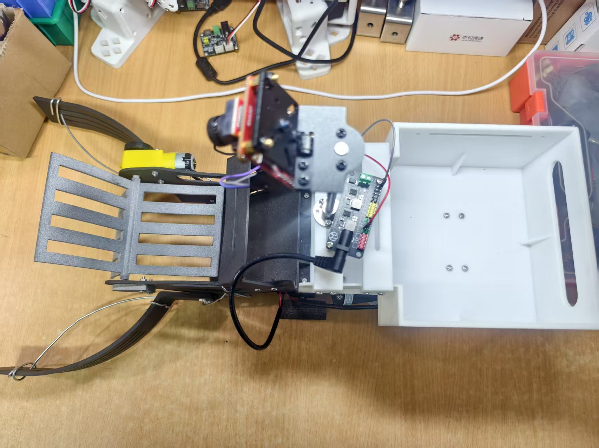
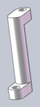
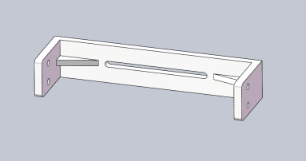
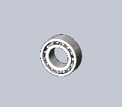

# Assembly References and Part Previews

[简体中文](README.zh-CN.md) | **English**

This directory collects full-car assembly photos and CAD previews of the main custom parts, for quick part identification and checking orientation/relative position during assembly.

> Previews are low-resolution images, **for identification and assembly reference only**. Dimensions, holes and tolerances are defined by the models in `solidworks/parts/` and `stl/`.

## Full-Car Assembly References

| Front collection mechanism | Full car, side A | Full car, side B |
|---|---|---|
|  |  |  |

| Full car, top view | Isometric view |
|---|---|
|  |  |

*Front three-quarter view: relative position of the front collector, the OpenMV mast and the rear storage bin.*

- Front: left/right guide claws, three-blade collector, OpenMV mount on top, rear storage bin.
- Side: relative position of the purchased four-wheel chassis and the custom upper collector; check bin height and the transition to the front channel.
- Top/isometric: check overall envelope and the bin-to-chassis relationship.

## Part Previews

| Storage bin | Bearing cover | Three-blade rotor | Blade shaft | Guide claws |
|---|---|---|---|---|
|  |  |  |  |  |
| **Front top baffle** | **Single bracket** | **Double bracket** | **Reinforced arch top** | **605.ZZ bearing** |
|  |  |  |  |  |

## Mapping

| Preview | Part | Model |
|---|---|---|
| `01-storage-box.png` | Storage bin | [`../solidworks/parts/后备箱.SLDPRT`](<../solidworks/parts/后备箱.SLDPRT>) · [`../stl/后备箱.STL`](<../stl/后备箱.STL>) |
| `02-bearing-cover.png` | Bearing cover | [`../solidworks/parts/盒盖.SLDPRT`](<../solidworks/parts/盒盖.SLDPRT>) · [`../stl/盒盖.STL`](<../stl/盒盖.STL>) |
| `03-blade.png` | Three-blade rotor | [`../solidworks/parts/叶片.SLDPRT`](<../solidworks/parts/叶片.SLDPRT>) · [`../stl/叶片.STL`](<../stl/叶片.STL>) |
| `04-blade-shaft.png` | Blade shaft (roller coupling) | [`../solidworks/parts/叶片轴（滚轴交接）.SLDPRT`](<../solidworks/parts/叶片轴（滚轴交接）.SLDPRT>) · [`../stl/叶片轴（滚轴交接）.STL`](<../stl/叶片轴（滚轴交接）.STL>) |
| `05-guide-claws.png` | Front bracket (left/right claws) | [`../solidworks/parts/左爪.SLDPRT`](<../solidworks/parts/左爪.SLDPRT>) · [`../solidworks/parts/右爪.SLDPRT`](<../solidworks/parts/右爪.SLDPRT>) |
| `06-front-top-baffle.png` | Front top baffle | [`../solidworks/parts/前挡顶.SLDPRT`](<../solidworks/parts/前挡顶.SLDPRT>) · [`../stl/前挡顶.STL`](<../stl/前挡顶.STL>) |
| `07-single-bracket.png` | Single bracket | [`../solidworks/parts/单支架.SLDPRT`](<../solidworks/parts/单支架.SLDPRT>) · [`../stl/单支架.STL`](<../stl/单支架.STL>) |
| `08-double-bracket.png` | Double bracket | [`../solidworks/parts/双支架.SLDPRT`](<../solidworks/parts/双支架.SLDPRT>) · [`../stl/双支架.STL`](<../stl/双支架.STL>) |
| `09-arch-top.png` | Reinforced arch top | [`../solidworks/parts/拱顶（强化）.SLDPRT`](<../solidworks/parts/拱顶（强化）.SLDPRT>) · [`../stl/拱顶(强化）.STL`](<../stl/拱顶(强化）.STL>) |
| `10-bearing-605zz.png` | 605.ZZ bearing | Purchased (5 × 11 × 5 mm) |

## Key Checks During Assembly

1. **Claw orientation**: curved openings face forward; do not swap left and right.
2. **Rotor clearance**: the rotor must not scrape the guide plates or bin inlet.
3. **Bearing/cover/shaft concentricity**: turn by hand before applying power.
4. **Bracket height**: single/double brackets, front top baffle and arch top together set the bin inlet height; verify alignment with the front channel.
