# 装配参考图与零件预览

本目录收集整车装配照片和主要自研零件的 CAD 预览，用于装配时快速认件、核对方向和相对位置。

> 预览图为低分辨率截图，**只用于认件和装配参考**；尺寸、孔位、公差以 `solidworks/parts/` 与 `stl/` 中的模型为准。

## 整车装配参考

| 前部收集机构 | 整车侧视 A | 整车侧视 B |
|---|---|---|
| 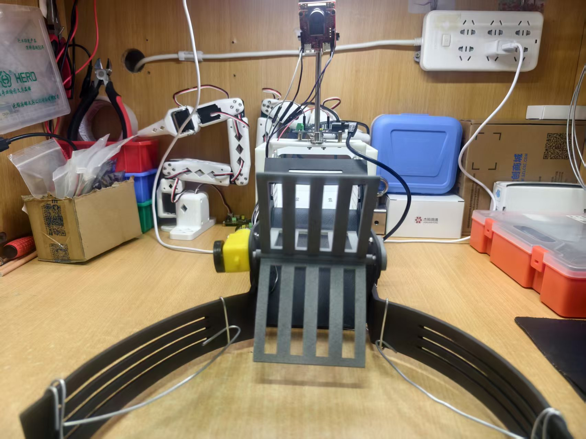 | 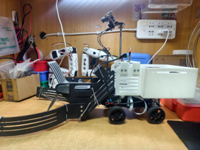 | 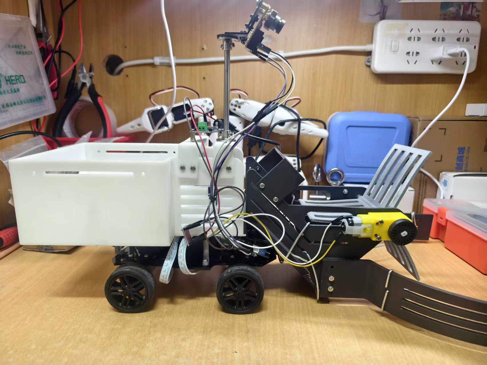 |

| 整车俯视 | 轴测视角 |
|---|---|
|  | 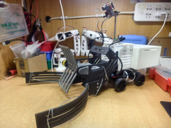 |

- 前部：左右导流爪、三叶片收集机构、顶部 OpenMV 支架、后置储球箱。
- 侧面：采购四轮底盘 + 自研上层收集机构的相对位置，注意后箱高度与前端通道的衔接。
- 俯视/轴测：核对整机包络、后箱与底盘的相对位置。

## 零件预览

| 后箱（储球箱） | 盒盖（轴承定位） | 叶片（三叶式） | 叶片轴（滚轴交接） | 左右导流爪 |
|---|---|---|---|---|
| 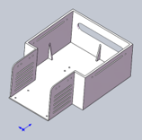 | 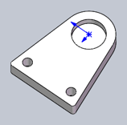 | 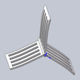 | 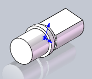 | 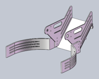 |
| **前挡顶** | **单支架** | **双支架** | **拱顶（强化）** | **轴承 605.ZZ** |
| 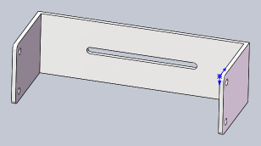 |  | 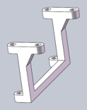 |  |  |

## 对应关系

| 预览文件 | 零件 | 对应模型 |
|---|---|---|
| `01-storage-box.png` | 后箱 / 储球箱 | [`../solidworks/parts/后备箱.SLDPRT`](<../solidworks/parts/后备箱.SLDPRT>) · [`../stl/后备箱.STL`](<../stl/后备箱.STL>) |
| `02-bearing-cover.png` | 盒盖 / 轴承定位 | [`../solidworks/parts/盒盖.SLDPRT`](<../solidworks/parts/盒盖.SLDPRT>) · [`../stl/盒盖.STL`](<../stl/盒盖.STL>) |
| `03-blade.png` | 叶片（三叶式） | [`../solidworks/parts/叶片.SLDPRT`](<../solidworks/parts/叶片.SLDPRT>) · [`../stl/叶片.STL`](<../stl/叶片.STL>) |
| `04-blade-shaft.png` | 叶片轴（滚轴交接） | [`../solidworks/parts/叶片轴（滚轴交接）.SLDPRT`](<../solidworks/parts/叶片轴（滚轴交接）.SLDPRT>) · [`../stl/叶片轴（滚轴交接）.STL`](<../stl/叶片轴（滚轴交接）.STL>) |
| `05-guide-claws.png` | 前端支架（含左右爪） | [`../solidworks/parts/左爪.SLDPRT`](<../solidworks/parts/左爪.SLDPRT>) · [`../solidworks/parts/右爪.SLDPRT`](<../solidworks/parts/右爪.SLDPRT>) |
| `06-front-top-baffle.png` | 前挡顶 | [`../solidworks/parts/前挡顶.SLDPRT`](<../solidworks/parts/前挡顶.SLDPRT>) · [`../stl/前挡顶.STL`](<../stl/前挡顶.STL>) |
| `07-single-bracket.png` | 单支架 | [`../solidworks/parts/单支架.SLDPRT`](<../solidworks/parts/单支架.SLDPRT>) · [`../stl/单支架.STL`](<../stl/单支架.STL>) |
| `08-double-bracket.png` | 双支架 | [`../solidworks/parts/双支架.SLDPRT`](<../solidworks/parts/双支架.SLDPRT>) · [`../stl/双支架.STL`](<../stl/双支架.STL>) |
| `09-arch-top.png` | 拱顶（强化） | [`../solidworks/parts/拱顶（强化）.SLDPRT`](<../solidworks/parts/拱顶（强化）.SLDPRT>) · [`../stl/拱顶(强化）.STL`](<../stl/拱顶(强化）.STL>) |
| `10-bearing-605zz.png` | 轴承 605.ZZ | 采购件（内 5 × 外 11 × 高 5） |

## 装配时重点看

1. **左右爪方向**：弧形开口朝前，左右件不要装反。
2. **叶片与通道间隙**：叶片旋转不得扫到导流板和后箱入口。
3. **轴承/盒盖/滚轴同轴度**：先手动转动确认无阻滞，再上电。
4. **支架高度**：单支架、双支架、前挡顶和拱顶共同决定后箱入口高度，装配后核对与前端通道是否对齐。
